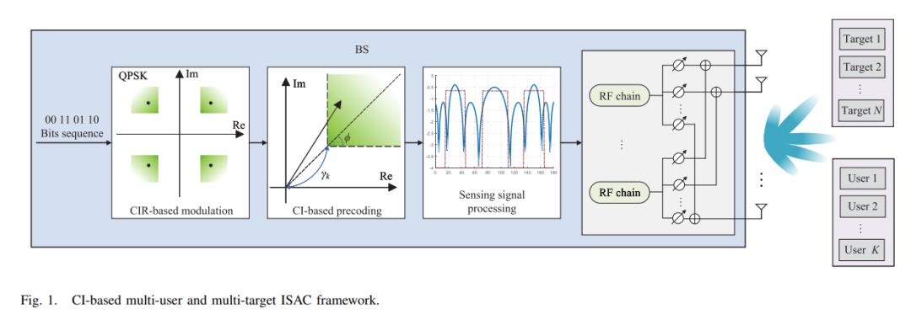
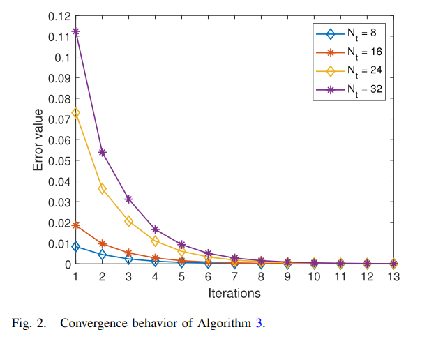
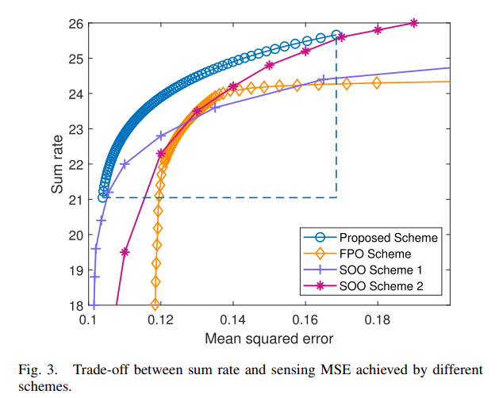
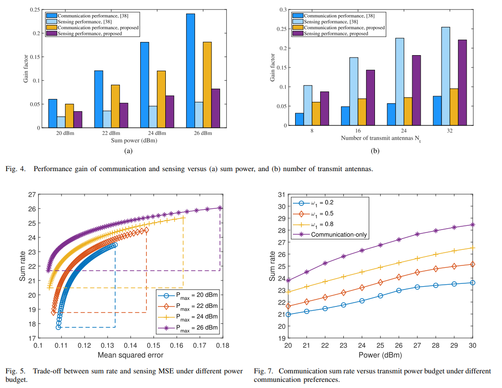
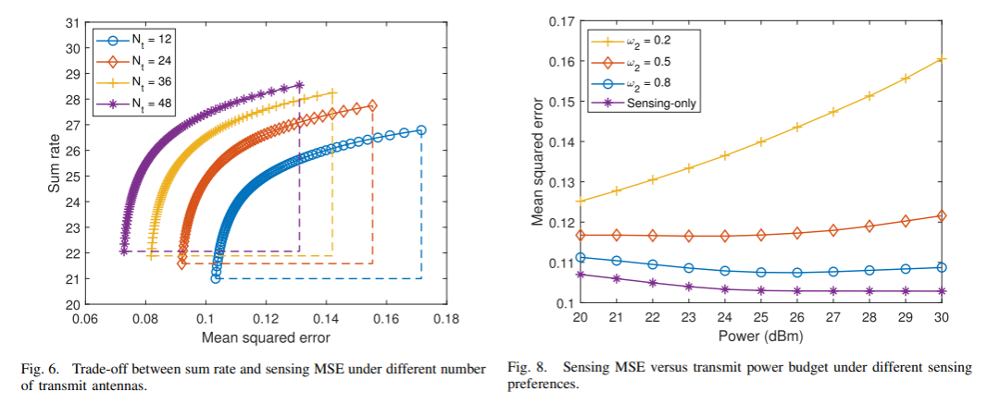
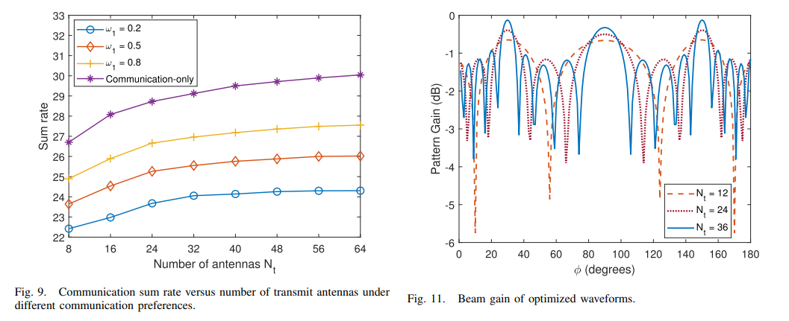

# MIMO-ISAC Based on Multi-Objective Optimization for Multi-User Multi-Objective MIMO-ISAC System Waveform Design [with MATLAB Code]

Integrated Sensory and Communications (ISAC) opens up new service possibilities for the sixth-generation (6G) systems by achieving coexistence of communication and sensory (C&S) functionalities through shared hardware platforms and wireless resources. This paper investigates waveform design issues in downlink multi-user multi-objective ISAC systems under different C&S performance preferences. Multi-user Interference (MUI) can severely degrade communication performance, hence, we introduce a constructive interference (CI) mechanism into the ISAC system to save communication power budget. However, due to conflicts between C&S metrics, it is challenging for the ISAC system to achieve optimal C&S objectives simultaneously, thus balancing C&S objectives is crucial. With the help of multi-objective optimization theory, we propose a weighted Chebyshev transform method to reconstruct the C&S trade-off problem as a Pareto optimal problem, thereby effectively handling constraints in the ISAC system. Finally, simulation results reveal the trade-off relationship between C&S performance, providing insights for flexible waveform design in MIMO-ISAC systems under different C&S performance preferences.
Introduction: Research Background and Significance
Integrated Sensory and Communications (ISAC) has attracted widespread attention from both academic and industrial communities due to its dual capabilities of communication and radar perception. The core lies in the similarity between communication and radar systems in terms of device, waveform, and signal processing algorithms, and the overlapping development of radar and communication bands towards high frequency segments such as millimeter waves, terahertz, and visible light, promoting the interoperability of communication and perception functions within existing wireless infrastructures. Therefore, ISAC is considered a key technology to alleviate the upcoming spectrum scarcity issue in 6G wireless systems, with its unified theoretical framework potentially driving paradigm innovation in future cellular architectures and network protocols.
Compared with the dedicated perception or communication framework, ISAC not only efficiently utilizes hardware, software and wireless resources but also realizes mutual enhancement of C&S dual functions. The integrated waveform is the foundation for realizing C&S dual functions, bringing integrated gain and coordinated gain. However, the design of integrated waveforms in current ISAC systems faces key challenges: 1) Flexible dynamic adjustment based on scene requirements and environmental changes. 2) The C&S function causes conflict and interference in the coexistence of same frequency and same time domain, which urgently needs a waveform design strategy that can adapt to complex requirements under strong interference.
II. Existing research in related fields can be categorized into three types according to the principle of waveform design:
Perceptual center type
By embedding communication data into the existing perception waveforms, radar is endowed with communication capabilities, but the transmission rate is relatively low and is only suitable for limited communication scenarios.
Communication center type
Direct radar perception using communication waveforms necessitates targeted design of the waveform to meet perceptual constraints (such as low peak-to-average power ratio, good correlation, etc.), yet perception capabilities are difficult to adjust and require complex signal processing compensation for performance losses.
Joint design type
Integrated waveform design is modeled as a mathematical optimization problem, taking into account C&S performance metrics. However, conflicts exist between these metrics, necessitating trade-offs to achieve performance optimization. Recent research has primarily focused on the performance boundary analysis of ISAC systems, but there has been limited quantitative analysis of how system parameters (such as the number of users, targets, and transmitting antennas) influence the trade-offs, especially the asymmetrical impact of power allocation on C&S performance gains.
III. Research Motivation and Challenges: Realistic Needs in Multi-User, Multi-Objective Scenarios
The single user/single target ISAC model has been widely studied, but in the multi-user scenario, MUI leads to a decrease in communication rate. It is necessary to reallocate the sensed power to meet communication needs, which indirectly reduces the sensed performance and makes the C&S coupling more complex.
Adaptation Challenges for Dynamic Performance Preferences
C&S performance requirements vary across different scenarios, making traditional waveform design inflexible. A universal optimization framework is needed to achieve efficient resource allocation.
The Necessity of Balanced Performance in C&S
- Multi-user, multi-target scenarios: The performance constraints of each user and target must be considered in coordination to further increase the coupling degree between C&S. This requires the optimization of similar "game" device coordination.
IV. Research Contributions and Structural Contributions
- Introduce CI mechanism into ISAC system, convert MUI into useful signals through CI precoding, reduce communication power consumption, and release more power for perception.
- Model joint waveform design as a multi-objective optimization problem (MOOP), propose methods based on weighted Chebyshev transformation to reconstruct it into Pareto optimization problem.
- Design an efficient algorithm based on successive convex approximation (SCA), combine geometric programming (GP) and semidefinite relaxation (SDR) to solve decoupled subproblems, and analyze the impact of emission parameters on C&S performance through simulation.
Structure
System model → Problem modeling → Optimization algorithm → Simulation verification → Conclusion.
Article illustrations
Conclusion This paper designs an ISAC scheme based on CI to handle MUI in multi-user, multi-target scenarios. This scheme improves perception performance indirectly by reducing communication power budget. To balance C&S performance, waveform design is modeled as MOOP, and methods based on weighted Chebyshev transformation are proposed to reconstruct it into a Pareto optimization problem without weak Pareto solutions. Different integrated waveforms are designed under different C&S preferences based on the Pareto front. Simulation results verify the effectiveness of the proposed scheme, revealing the impact of parameters such as emission power and antenna number on the trade-off between C&S performance, providing theoretical support for flexible waveform design in ISAC systems.
End

## Images

<!-- PAYMENT_BLOCK -->

## Get this dataset

- Payment link (Stripe): [Buy now](https://buy.stripe.com/3cs8yP7sY87d0vu9AB)
- Payment QR code: 

<!-- /PAYMENT_BLOCK -->
